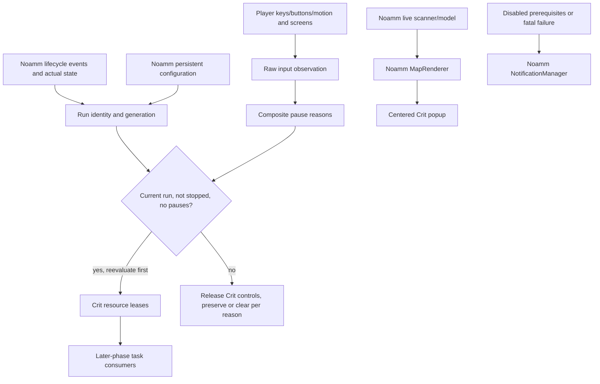

# Phase 1: Live Map and Safe Task Control - Research

**Researched:** 2026-11-12
**Domain:** Kotlin/Fabric 26.2, exact Noamm 1.3.5 cheat integration, map presentation and session control
**Confidence:** HIGH for inspected contracts; MEDIUM for integration recommendations; live mechanics unverified.

<user_constraints>
## User Constraints (from CONTEXT.md)

The following decisions/discretion/deferred sections are copied verbatim. Source: [VERIFIED: 01-CONTEXT.md].

### Settings versus execution

- **D-01:** Only the player turns an automatic mode off in settings. Esc, fatal errors and lifecycle termination must not programmatically disable that setting. This explicit correction supersedes the user's initial numeric answers that appeared to approve disabling it.
- **D-02:** Esc stops current automation/calculation and clears queued work. A fatal error stops current automation and clears queued work with the already-required explanation/diagnostics. Neither may immediately restart the still-enabled mode during the same run.
- **D-03:** After Esc or a fatal error, an enabled mode automatically starts fresh in the next dungeon run. Deliberately toggling a mode off/on is an explicit restart action; passive validity checks or closing a screen are not restart actions after cancellation.
- **D-04:** Boss entry, run completion, dungeon exit and disconnect terminate execution, clear queued tasks and preserve the enabled setting. A new valid dungeon starts fresh, never restoring unfinished tasks.
- **D-05:** Enabled mode selection persists across closing and relaunching Minecraft. Preserve configuration only, not an old execution/queue. No automated boss combat.

### Player input, screens and pauses

- **D-06:** Player input is not blocked. Manual input temporarily freezes automated movement/combat and preserves active objectives and queued work. The voice discussion initially mentioned blocking but explicitly clarified pause-and-resume afterward; follow the final clarification.
- **D-07:** Resume automatically when the player's manual input finishes, controls are released or the GUI closes, subject to remaining pause/lifecycle conditions. No explicit unpause control is requested. Resume must reevaluate actual state before continuing actions affected by manual movement.
- **D-08:** Ordinary manual-input and GUI pause/resume is silent: no transient paused/resuming toasts or status messages. This does not remove required dependency notifications, fatal-error explanations, diagnostics or later optimization progress.
- **D-09:** Retain the already-approved general GUI pause rule, including preserving work. A required loadout coordinator may close a conflicting screen for its operation. Do not introduce another screen-closing exception without an explicit gameplay decision.
- **D-10:** Death preserves work until revival, then reevaluates current state and replans before resume. Independent pause reasons cannot accidentally resume work while another reason still applies.

### Map appearance and interaction boundary

- **D-11:** Use a centered, medium-sized popup with the game visible around it. Keep Noamm room colors, identities and rendering. The user selected this layout and delegated further cosmetic details.
- **D-12:** Preserve configurable default M toggle and keep the popup open after commands, as already approved. Do not invent unavailable rooms or imply unimplemented room actions work in Phase 1.
- **D-13:** Reuse Noamm's existing notification presentation for dependencies and errors; no new notification engine or cosmetic-question rounds. Name the actual feature/setting the player must enable.

### Agent's discretion

- Choose routine dimensions, spacing, backdrop opacity and existing Noamm styling without further user questions.
- Use established Noamm presentation patterns for existing room information and unavailable actions. Do not add new capabilities merely to fill the UI.
- Keep discussion focused on substantive gameplay choices; the user explicitly rejected further trivial appearance questions.
- Define implementation details such as raw manual-input detection, input-source separation, resource release and idle detection in research/planning. Do not interpret the automation's own inputs as manual overrides or create endless pause/resume oscillation.

## Later-Phase Decisions Already Identified

- **Blood deadline versus GUI/manual pauses:** Still requires an explicit substantive decision before the Blood controller is implemented. The user has not authorized ignoring manual interaction or auto-closing screens for Blood timing. Phase 1 must not invent such behavior.
- **Impossible one-second arrival and no-LOS secret feasibility:** Retain the existing stop/report constraints and investigate in the affected movement/secret/Blood phases. Do not promise impossible timing or weaken visibility.
- **Auto Clear post-camp transition:** Remains an explicit Phase 6 planning gate while score is insufficient.

No new features were requested or deferred from approved v1 scope. These are existing later-phase decisions, not scope reductions.
</user_constraints>

## Summary

Use the existing addon build and Noamm's public map renderer, scanner getters, Feature/settings and notifications. Exact installed bytecode confirms these entry points; map rendering does not require an accessor or a copied renderer. The pinned release source shows a ready-made centered, scaled call in MapLeapRenderer. [VERIFIED: artifact javap; pinned MapRenderer.kt, MapLeapRenderer.kt]

Build the genuinely new shared session coordinator around separate persistent configuration, run identity, cancellation generation, pause reasons and owner-scoped resource leases. This is a design recommendation derived from D-01–10 and TASK-07, not an existing Noamm implementation. Its production consumers are later phases: Phase 1 must deliver map viewing and testable safe control without pretending travel/combat/secrets are available. [VERIFIED: 01-CONTEXT.md; REQUIREMENTS.md]

**Primary recommendation:** Implement the public map adapter and pure coordinator first, then integrate narrow input/lifecycle observation and validate against the exact JAR; keep live and release checks explicit. [VERIFIED: inspected contracts and phase boundary]

## Architectural Responsibility Map

| Capability | Primary Tier | Secondary Tier | Rationale / provenance |
|---|---|---|---|
| Popup, keybind, dependency explanation | Minecraft client GUI | Noamm presentation | Existing drawing/settings/notifications are client systems. [VERIFIED: template; artifact] |
| Room discovery, identities, colors | Noamm client map services | Crit read adapter | Use scanner and renderer, never construct a parallel dungeon model. [VERIFIED: pinned map sources] |
| Run lifecycle, stop latch, pauses | Crit client coordinator | Noamm events/state | New orchestration required by D-01–10. [VERIFIED: CONTEXT.md] |
| Resource ownership/cancellation | Crit client coordinator | Noamm supported action helpers | TASK-07 requires Crit-only cleanup. [VERIFIED: REQUIREMENTS.md; ActionUtils.kt] |
| Persistent selection/keybind | Noamm configuration | Local storage | Runtime tasks must remain ephemeral. [VERIFIED: KeybindSetting Savable; CONTEXT.md D-05] |
| Release artifact/evidence | Build/release tooling | GitHub Releases | Required by REL-01–02. [VERIFIED: REQUIREMENTS.md] |

<phase_requirements>
## Phase Requirements

Descriptions below reproduce REQUIREMENTS.md. [VERIFIED: .planning/REQUIREMENTS.md]

| ID | Description | Research Support |
|---|---|---|
| CORE-02 | Every feature and partial implementation reuses applicable Noamm functionality, with exact-dependency evidence before anything is declared absent. | Public APIs and artifact hash/signature inventory below |
| CORE-03 | Player finds every new feature and setting under the Crit Addons tab in Noamm's menu. | Adapt existing category mixin and matching feature package |
| CORE-04 | Missing required Noamm features/settings produce existing Noamm toasts naming what the player must enable. | Dungeon Map, Map Enabled, Cheater Map and NotificationManager |
| CORE-05 | Each of the six feature areas has distinct research and implementation agents, with explicit shared-service ownership and no inspection of older projects without new permission. | Ownership and constraints below |
| MAP-01 | Popup displays Noamm Cheater Map's actual available rooms, identities and layout, updating during the run without inventing unavailable information. | Public live renderer, Unknown handling and scanner |
| MAP-02 | Player toggles the popup with configurable default M; issuing commands leaves it open. | KeybindSetting and Screen boundary |
| TASK-02 | Esc cancels current execution/calculation and clears queued tasks without an unexpected restart; ordinary manual movement does not cancel automation. | Run-scoped stop latch and raw input separation |
| TASK-03 | Opening a GUI pauses movement/combat while preserving work; closing it resumes, except the loadout coordinator may close conflicting screens for a required switch. | Composite pauses and explicit loadout-only exception |
| TASK-04 | Death suspends and preserves work; revival reevaluates state, replans from the actual position and resumes. | Noamm death/ghost state and resume barrier |
| TASK-05 | Disconnect, dungeon exit, run end and boss entry terminate automation, clear tasks and reset state without carrying work to another run. | Noamm events plus state guards and generation invalidation |
| TASK-07 | Movement, aiming, hotbar, GUI and combat operations share exclusive coordinated ownership and cancellation without canceling unrelated Noamm work. | Owner-scoped leases; no global ActionUtils.reset |
| DIAG-03 | Before affected implementation, resolve rearming after Esc/fatal stops, map/GUI pause versus Blood deadlines, Auto Clear's post-camp transition, no-LOS secret feasibility and impossible-deadline behavior explicitly rather than silently weakening requirements. | Phase 1 decisions settled; later gates preserved |
| REL-01 | Every completed feature or bug fix has a matching semantic Git tag and GitHub Release starting at v0.1.0, a downloadable compiled 26.2 JAR and notes describing additions, changes and removals. | Release gate and environment audit |
| REL-02 | Release evidence ties the JAR to its source/version and completed-feature verification; planning/docs/incomplete work produce no individual release or automatic phase tag, and unperformed live tests are disclosed. | Source/artifact manifest and disclosure checks |
</phase_requirements>

## Project Constraints (from AGENTS.md)

- Read STATE, PROJECT, REQUIREMENTS and active context; preserve the approved six-phase Vertical MVP and all 53 requirements. [VERIFIED: AGENTS.md]
- Work only in this repository and intended dependencies; no historical custom projects without new permission. None were inspected for this research. [VERIFIED: AGENTS.md; this research's tool scope]
- Verify exact installed Noamm 1.3.5 cheat plus release-pinned source; reuse applicable systems and partial implementations. Prefer narrow version-specific bridges; do not copy Noamm systems. [VERIFIED: AGENTS.md]
- Target 26.2/JDK 25/Kotlin/Fabric/Stonecutter; preserve version handling but ship only 26.2. [VERIFIED: AGENTS.md]
- Put new features/settings under Crit Addons and use existing named dependency/error toasts. [VERIFIED: AGENTS.md]
- Six feature implementation owners must differ from each other and their researchers; one impl-coordinator owns shared contracts; record identities and file ownership and preserve others' edits. This research owner is `/root/phase1_research`; coordinator must record the map implementation identity separately before edits. [VERIFIED: AGENTS.md; active assignment]
- Exact secrets need a complete finite model/proof and separate exploration/optimization/verification/execution; preserve cached route sequencing and crouched-eye/network constraints in later phases. [VERIFIED: AGENTS.md]
- Preserve Esc, GUI, death and lifecycle policies; no new exception for Blood deadlines or post-camp behavior. Boss entry/exit/disconnect/run end clear tasks; no boss combat or carry-over. [VERIFIED: AGENTS.md]
- Completed features/fixes require semantic tag and GitHub Release with compiled 26.2 JAR, source/version evidence and additions/changes/removals starting v0.1.0; planning/docs/incomplete work have no automatic release/tag. [VERIFIED: AGENTS.md]
- Start edits through GSD; use codex/ for new branches; meaningful unresolved product decisions need answers. Research runs under the parent gsd-plan-phase workflow and writes only this file; parent handles commits. [VERIFIED: AGENTS.md; parent assignment]
- No project skills, rules directories or graph.json were present in the inspected working tree. [VERIFIED: repository directory/file inventory]

## Standard Stack

Retain repository pins; do not upgrade merely to follow current ecosystem versions. These are project configuration versions, not registry-freshness or package-legitimacy claims. Phase 1 requires no newly selected external package. [VERIFIED: gradle.properties; versions/26.2/gradle.properties; build.gradle.kts]

| Component | Pinned version | Purpose / evidence |
|---|---|---|
| Minecraft / Java | 26.2 / 25 | Required target, Java toolchain and Kotlin JVM target [VERIFIED: build.gradle.kts] |
| NoammAddons | 1.3.5, classifier 26.2-cheat | Non-transitive implementation dependency from Noamm GitHub releases [VERIFIED: build.gradle.kts; version properties] |
| Kotlin / Fabric Kotlin | 2.4.21 / 1.14.2+kotlin.2.4.21 | Existing runtime/compiler [VERIFIED: gradle.properties] |
| Fabric Loader / API | 0.19.5 / 0.161.0+26.2 | Existing platform [VERIFIED: version properties] |
| Loom / Stonecutter | 1.19.1 / 0.9.8 | Existing build/version management [VERIFIED: gradle.properties] |
| Gradle wrapper | 9.8.2 | Distribution URL and SHA256 pinned [VERIFIED: gradle-wrapper.properties] |

**Installation:** No new package installation recommended. Use existing declared dependencies. Package Legitimacy Gate is not applicable to new packages in this phase. Maven publication dates were not independently checked; do not describe the pinned versions as latest. [VERIFIED: inspected build scope]

## Exact Dependency Evidence

Installed artifact: `C:\Users\Michael\AppData\Roaming\PrismLauncher\instances\26.2\minecraft\mods\NoammAddons-1.3.5-26.2-cheat.jar`; SHA256 `6212888DDCE467FB0DA81BC3DF9E285C39867FC8AA9547BB4976EEC911F3F6FD`. Inspected with jar/javap only; no dependency class execution. [VERIFIED: Get-FileHash; jar tf; javap -p/-c]

Pinned official source was fetched read-only directly from commit `460cfaf5d8760fa1146f5d2433715b7eca9bf319`; no dependency checkout exists inside this repository. Do not substitute HEAD or assume public source covers binary-only cheat behavior. [VERIFIED: repository inventory; successful raw GitHub fetches; AGENTS.md]

All signatures below use `com.github.noamm9.` prefix unless explicitly Minecraft. [VERIFIED: installed artifact javap]

| Contract | Exact inspected JVM-facing API | Bridge decision |
|---|---|---|
| Map draw | `features.impl.dungeon.map.MapRenderer.draw(net.minecraft.client.gui.GuiGraphicsExtractor, boolean, boolean): kotlin.Pair<Float, Float>` | Public; call directly |
| Map config | `MapConfig.getMapEnabled(): ToggleSetting`, `getDungeonMapCheater(): ToggleSetting` | Public; inspect values without changing them |
| Map scanner | `DungeonScanner.getDungeonList(): Tile[]`, `getUniqueRooms(): Map<String, UniqueRoom>`, `getDoorTiles(): List<DoorTile>` | Public; no reflection/private accessor needed |
| Toast | `ui.notification.NotificationManager.push(String, String, long): void` | Public; Kotlin default duration supported by generated default method |
| Keybind | `config.types.KeybindSetting(String,int)`, `isDown(): boolean`, `isPressed(): boolean`, `matches(int,boolean): boolean` | Existing configurable/savable keybind |
| Key event | `KeyboardEvent.KeyPressed(KeyEvent,int)`; getters `getKeyEvent()`, `getAction()` | Press/repeat only: raw RELEASE not posted |
| Mouse button | `MouseClickEvent(int,int,int)`; getters button/action/modifiers | Both actions observed by source callback; motion needs separate observer |
| Shared actions | `ActionUtils.queue(int,boolean,Function1<Continuation<Unit>,Object>): void`, `reset(): Unit`, `waitTicks(int,Runnable,Continuation<Unit>): Object` | Priority queue/global reset; not a Crit ownership API |
| Client scheduling | `ThreadUtils.scheduledTask(Number,Runnable): void` | Wrap Crit callbacks with generation/lease checks |
| Location | Public static `inDungeon`, `inBoss`, `dungeonFloor`, `dungeonFloorNumber`, `serverId` | Reuse, but none alone is a durable run ID |

Actual UI names are **Dungeon Map** (Feature name derived from DungeonMap), **Map Enabled**, **Cheater Map**. Renderer.toggle requires DungeonMap.enabled and Map Enabled; Cheater Map controls the required discovery rendering. Toast the exact disabled prerequisites when opening; do not auto-enable them. Scanner itself registers globally and scans on TickEvent.End when floor exists and not in boss, approximately every 250 ms in pinned source; do not duplicate scanning or promise completeness. [VERIFIED: pinned Feature.kt, DungeonMap.kt, MapConfig.kt, MapRenderer.kt, DungeonScanner.kt; artifact corresponding public APIs]

## Architecture Patterns

### System Architecture Diagram

Design recommendation grounded in the inspected contracts and locked decisions. [VERIFIED: CONTEXT.md; APIs above]



### Component Responsibilities / Recommended Structure

Use these proposed boundaries, adapting names to final category registration. They are new design, not existing files. [VERIFIED: phase contracts; template package/category mechanism]

| Owner | Proposed responsibility/files |
|---|---|
| impl-coordinator | `crit/control/`: pure session reducer, run generations, pause reasons, resources, cancellation token and adapters; shared contracts owned once |
| map implementation agent, distinct from researcher | `features/impl/critaddons/`: map feature, popup, public Noamm map adapter and dependency checks |
| impl-coordinator | Narrow `mixins/` raw key-release/mouse-motion observation and lifecycle marshalling |
| release/coordinator owner | Category/template identity/config resources, 26.2 build/release manifest |

### Pattern 1: Session identity and persistent settings are separate

Keep persistent mode selection in Noamm configuration. Keep runtime `{runEpoch, executionGeneration, activeTask, pendingTasks, stopReason, pauseReasons, leases}` in memory only. A generation changes on stop/replacement; a run epoch changes only for a genuinely fresh valid run, not on GUI closure, death/revival or temporary state unavailability. Mark terminated epochs closed; repeated or delayed events are idempotent and cannot reopen them. Explicit user off/on can rearm the current valid run. [VERIFIED: design derived from D-01–05, TASK-05]

Reuse RunStartedEvent, RunEndedEvent, BossEnterEvent, PlayerDeathEvent and WorldChangeEvent; also guard actual connection/level, location, boss and ended state before side effects. Pinned DungeonListener posts some events from coroutines; LocationUtils detects boss entry from outgoing movement packets. Marshal event facts onto the client thread before touching session/world/UI and fence delayed callbacks with generation identity. Do not assume EventBus posting always occurs on the client thread. [VERIFIED: pinned DungeonListener.kt; LocationUtils.kt; artifact event inventory]

On world/disconnect/exit/boss/end: revoke Crit leases, neutralize only Crit-produced controls, invalidate generation, clear active/pending work and retain persistent settings. On Esc/fatal: same cleanup plus a same-run stop latch. No validity check may remove this latch. At application startup restore selection only; never load unfinished runtime queues. [VERIFIED: D-01–05]

### Pattern 2: Composite pauses and revalidation barrier

Represent pause reasons as a set, not a toggled boolean: manual controls, GUI, dead/ghost (and unavailable context when appropriate). Adding a reason releases/neutralizes Crit movement/combat without deleting objectives. Removing a reason cannot resume while others remain. Transition to runnable first requests reevaluation/replanning from actual state, then reacquires leases; never replay stale movement actions. Ordinary transitions emit no user-facing messages. Treat this popup as a GUI pause too. Only the future required loadout coordinator receives the approved screen-closing capability. [VERIFIED: D-06–10; TASK-03–04]

### Pattern 3: Observe genuine input; do not infer it from automation effects

Pinned KeyboardMixin injects at KeyboardHandler.keyPress HEAD but explicitly returns on RELEASE (bytecode `iload_3; ifne; return` corroborates). A held-input set built solely from Noamm KeyPressed events cannot reliably clear. Reuse existing press/Esc/button events where sufficient; add a narrow non-cancelling 26.2 key-release/window-focus observer and raw mouse-motion observation, validating exact target descriptors against mapped 26.2 classes during execution. Do not infer manual movement from keyMapping.isDown, player position, yaw changes, outgoing packets or resolved KeyboardInput: automation/Noamm can modify those. [VERIFIED: pinned KeyboardMixin.java, MixinMouseHandler.java, MixinKeyboardInput.java; installed bytecode]

Track physical press/release and last raw mouse activity independently of synthetic actions. Ignore autorepeat as a new action; ignore map-toggle input as a permanent held movement override. Clear held observations on focus loss to prevent stuck pauses; retain GUI/context pauses. Resume after raw buttons/keys release and mouse activity ceases, then revalidate. Choose a small documented tick-based mouse idle debounce and test it against oscillation; no gameplay deadline bypass is authorized. Exact 26.2 mouse-motion callback descriptor and debounce threshold remain implementation validation items, not verified APIs. [VERIFIED: design required by D-06–10 and discretion; ASSUMED: final motion idle threshold usability]

### Pattern 4: Owner-scoped resource leases

Acquire resource sets atomically for movement, rotation, hotbar, GUI and combat. Lease identity includes task owner, run epoch and generation. Every delayed callback checks that identity before any side effect. Release/cleanup is idempotent and scoped to that owner; never restore an old hotbar/rotation over a player's newer choice. Cancellation must revoke future effects before dropping objective references. Preserve the queue/objective during pauses, and reacquire only after revalidation. [VERIFIED: design derived from TASK-07; D-06–10]

Do not call ActionUtils.reset on Crit Esc/fatal: pinned reset clears the entire shared priority queue and cancels its processing job. Do not queue Crit work with blockInput=true: it suppresses keyboard/mouse events, violating D-06 and potentially Esc observation. The shared API has no public owner-specific removal signature in the inspected artifact. Prefer Crit-owned cancellable jobs using Noamm low-level helpers and generation-guarded scheduling; if a later Noamm helper queues opaque shared actions, audit its full behavior before claiming cancellation isolation. Crit leases serialize cooperating Crit consumers; they cannot alone guarantee exclusive access against unrelated Noamm features. Detect/yield to actual conflicting control where observable and test coexistence; never silently cancel unrelated features. [VERIFIED: ActionUtils.kt; artifact public API; TASK-07]

### Anti-Patterns to Avoid

- Disabling the mode to stop it, reopening a stopped epoch after a GUI closes, or persisting runtime work. [VERIFIED: D-01–05]
- Copying map geometry/rendering or treating LeapMenu's teammate click as room navigation. [VERIFIED: pinned MapLeapRenderer.kt]
- Rendering example=true outside a dungeon as actual data; replacing Unknown tiles with invented rooms. Renderer uses MapPreview for examples and skips Unknown during room rendering. [VERIFIED: MapRenderer.kt]
- Assuming draw is pure: applyCheater changes UNOPENED tile states to UNDISCOVERED; preserve Noamm semantics instead of deep-copying a competing model. Draw also returns 140px height when mapExtraInfo is enabled even with extraInfo=false; account for background sizing in popup bounds. [VERIFIED: MapRenderer.kt]
- Claiming Phase 1 room actions execute. Commands belong to later phases; keep unavailable actions visibly unavailable and do not close the popup on command dispatch. [VERIFIED: CONTEXT.md boundary, D-12]

## Don't Hand-Roll

| Problem | Don't build | Use instead / provenance |
|---|---|---|
| Map discovery/colors/room labels | New scanner, room renderer or fake topology | DungeonScanner/MapRenderer/MapConfig [VERIFIED: pinned sources; artifact] |
| User keybind persistence | Separate JSON/keybind engine | KeybindSetting and existing Noamm config [VERIFIED: artifact Savable/API] |
| Dependency/error presentation | New toast system | NotificationManager.push [VERIFIED: artifact; D-13] |
| Feature menu/category | Independent menu | Existing Feature + category registration pattern [VERIFIED: template] |
| FIFO/session ownership | Reinterpret Noamm priority queue as FIFO | New Crit coordinator above reused helpers [VERIFIED: ActionUtils.kt; project requirements] |

## Common Pitfalls

| Pitfall | Cause / warning sign | Prevention / provenance |
|---|---|---|
| Infinite manual pause | No release events in KeyPressed stream | Narrow raw release observer and focus-loss test [VERIFIED: KeyboardMixin] |
| Endless pause/resume oscillation | Synthetic keys/rotation counted as manual | Separate callback-origin observations from synthetic output [VERIFIED: D-06–10] |
| Accidental restart | enabled and running are one flag | Same-run latch with explicit off/on or fresh-run rearm only [VERIFIED: D-01–05] |
| Stale callback moves player after stop | Coroutine already scheduled before cancellation | Generation/lease check immediately before each side effect [VERIFIED: design from TASK-07] |
| GUI closes but death still applies | Single pause boolean | Reason set + resume barrier [VERIFIED: D-10] |
| Unrelated Noamm work disappears | Global ActionUtils.reset | Owner-specific cleanup; no global reset [VERIFIED: ActionUtils.kt] |
| Wrong source contracts | Mutable HEAD or old 1.21 GUI signatures | Installed hash + pinned commit + 26.2 descriptors [VERIFIED: AGENTS.md; inspected signatures] |
| Double map toggle | Repeats or edge check called twice | One edge detector/owner per bind [VERIFIED: KeybindSetting API; proposed design] |

## Code Examples

Verified drawing pattern abridged from pinned MapLeapRenderer.kt; run on the client rendering path with balanced Resolution/pose stacks. Actual popup bounds/backdrop come from UI design. [VERIFIED: pinned MapLeapRenderer.kt]

```kotlin
Resolution.push(ctx)
val scale = popupScale
val mapOx = (Resolution.width - 128f * scale) / 2f
val mapOy = (Resolution.height - 128f * scale) / 2f
val pose = ctx.pose()
pose.pushMatrix()
pose.translate(mapOx, mapOy)
pose.scale(scale)
MapRenderer.draw(ctx, example = false, extraInfo = false)
pose.popMatrix()
Resolution.pop(ctx)
```

Public Noamm dependency checks/toast shape; names are source verified. This is illustrative integration code, not compiled research output. [VERIFIED: MapConfig.kt; Feature.kt; artifact NotificationManager API]

```kotlin
val missing = buildList {
    if (!DungeonMap.enabled) add("Dungeon Map")
    if (!MapConfig.mapEnabled.value) add("Map Enabled")
    if (!MapConfig.dungeonMapCheater.value) add("Cheater Map")
}
if (missing.isNotEmpty()) {
    NotificationManager.push("Crit Addons", "Enable: ${missing.joinToString()}")
    return
}
```

Coordinator invariant sketch (proposed new code, grounded in locked decisions): no action passes without current ownership and no pauses; a resumed task enters revalidation before execution. [VERIFIED: D-01–10; TASK-07]

```kotlin
fun canAct(token: LeaseToken): Boolean =
    token.runEpoch == currentRunEpoch &&
    token.generation == executionGeneration &&
    stoppedRunEpoch != currentRunEpoch &&
    pauseReasons.isEmpty() &&
    !requiresRevalidation && leases.owns(token)
```

## State of the Art

| Earlier assumption | Verified contract / impact |
|---|---|
| Older Minecraft GUI examples use legacy drawing context types | Artifact uses GuiGraphicsExtractor; current Fabric custom screens docs explicitly select Minecraft 26.2. Validate overrides against those mappings. [VERIFIED: javap; CITED: docs.fabricmc.net/develop/rendering/gui/custom-screens] |
| A key event stream necessarily includes releases | Pinned Noamm KeyboardMixin filters them; observer required. [VERIFIED: source and bytecode] |
| Source HEAD describes installed Noamm | Release commit is the project contract; artifact still governs cheat behavior. [VERIFIED: AGENTS.md] |

## Environment Availability

| Dependency | Required By | Available | Version/evidence | Fallback |
|---|---|---|---|---|
| Installed target Noamm JAR | Reuse/compatibility | Yes | Hash above [VERIFIED: file/hash/javap] | None needed |
| java/javap/jar on PATH | Inspection/build | Yes, Java is wrong build target | Temurin 21.0.10 [VERIFIED: java -version/Get-Command] | Locate/provision authorized JDK 25 before build |
| JDK 25 | Required compiler/runtime | Not established | Only JDK 21 directory found under Eclipse Adoptium; other locations not exhausted [VERIFIED: directory probe] | Execution must find/check JDK 25; do not assume absent globally |
| Gradle wrapper | Build/test | Files present, execution untested | 9.8.2 pinned [VERIFIED: wrapper properties] | No build run in research |
| GitHub CLI | Releases | Installed, unauthenticated | gh auth status reports not logged into any hosts [VERIFIED: command] | Establish authorized publishing route before release |
| Context7 | Documentation | MCP absent; ctx7 not found | Tool metadata/Get-Command [VERIFIED: probes] | Pinned official sources + official Fabric docs used |

**Missing dependencies with no established fallback:** Working JDK 25 selection and authenticated release publishing are execution/release prerequisites. Existing GitHub connector authorization was not tested here. No build, dependency execution, game launch, JAR installation or live dungeon test was performed. [VERIFIED: probes and research tool actions]

## Validation Architecture

Nyquist is enabled. No tests/test config were found; the template build has no test dependencies or test tasks configured beyond Gradle defaults. Establish a JVM test harness that exercises pure coordinator classes without loading Noamm/Minecraft. Do not select a new test package until its official/registry provenance and legitimacy gate have been completed; a dependency-free Java assertion harness launched through Gradle JavaExec is a viable initial path. Test-command names below are proposed tasks to create, not existing runnable commands. [VERIFIED: config.json; file inventory; build.gradle.kts]

### Test Framework

| Property | Value |
|---|---|
| Framework | Proposed dependency-free JVM invariant harness; no new external package |
| Config | Wave 0: define `:26.2:controlTest` JavaExec task and test source set |
| Quick run | `./gradlew.bat :26.2:controlTest` (target warm execution under 30s; not benchmarked) |
| Full suite | `./gradlew.bat :26.2:controlTest :26.2:build` |
| Live gate | Exact installed 26.2 instance, map/session scenario checklist; separately recorded |

The proposed task path follows Stonecutter's registered 26.2 project; confirm with Gradle task inventory when execution is authorized. Cold dependency download/build duration is not a sub-30s guarantee. [VERIFIED: settings.gradle.kts; ASSUMED: harness warm execution duration]

### Phase Requirements → Test Map

| Req IDs | Behavior | Type / command | File exists? |
|---|---|---|---|
| CORE-02, CORE-04 | Exact artifact method/setting contracts; disabled prerequisites yield named Noamm toast | Static ABI check + integration/live dependency checklist | No — Wave 0 |
| CORE-03, MAP-01–02 | Crit category; M/rebind; real dynamic map/unknown rooms; popup retained | Pure binding edge tests via controlTest + live GUI/render checks | No — Wave 0 |
| CORE-05 | Distinct researcher/implementation identities and ownership | Artifact/document review before execution | No — ownership record required |
| TASK-02 | Esc cancels active/calculation/queue; same-run stopped; explicit off/on and next-run rearm | controlTest state sequences | No — Wave 0 |
| TASK-03–04 | GUI+manual+death overlap; silent resume only after all clear and reevaluation | controlTest + live ghost/revival/screen/input checks | No — Wave 0 |
| TASK-05 | Each terminal event clears work; duplicate/out-of-order events cannot reopen; old callbacks fenced | controlTest event trace/property cases | No — Wave 0 |
| TASK-07 | Atomic lease conflict; cancel one owner; unrelated sentinel still executes; stale callback no effect | controlTest plus actual Noamm coexistence check | No — Wave 0 |
| DIAG-03 | Phase 1 rearm/pause decisions implemented; later gates still explicit | Contract review + controlTest | No — Wave 0 |
| REL-01–02 | Version/tag/source/JAR hash/release URL match; additions/changes/removals and live limits present | Release manifest inspection and downloadable asset verification | No — release prerequisite |

### Sampling Rate

- Per task commit: pure control harness plus affected ABI/static checks. [VERIFIED: proposed validation derived from requirements]
- Per wave: full 26.2 checks/build after JDK 25 setup; no repeated game launch needed for pure reducer edits. [VERIFIED: phase validation recommendation]
- Phase gate: required checks and live map/input/lifecycle evidence, then matching release. State explicitly if a live scenario was not exercised; do not assert it passed from a fake event test. [VERIFIED: REQUIREMENTS.md acceptance/REL-02]

### Wave 0 Gaps

- Define coordinator test source set/task with no dependency loading; split pure models from Noamm adapters. [VERIFIED: no current harness]
- Add session, composite-pause, raw-input classification, lease and stale-callback test scenarios. [VERIFIED: requirements above]
- Add ABI check against exact artifact hash/signatures and live scenario evidence template. [VERIFIED: CORE-02/REL-02]
- Verify screen overrides, key-release and mouse-motion mixin descriptors on mapped 26.2 before compilation. [VERIFIED: inspected API gaps]
- Secure JDK 25 and authorized release route; create semantic v0.1.0 source/version manifest only for the completed increment. [VERIFIED: AGENTS.md; availability probes]

## Security Domain

Security enforcement is enabled at level 1 in config. This is a local Minecraft addon, with no new HTTP service, authentication or cryptography in Phase 1. ASVS is a web application/service standard; use it as a relevance checklist rather than falsely certify this addon. Current official ASVS is 5.0.0 (published 2025-05-30), so legacy V2-auth/V3-session numbering in generic templates must not be presented as current categories. [VERIFIED: config.json; phase scope; CITED: asvs.owasp.org]

| ASVS-related area | Applies here | Control recommendation / provenance |
|---|---|---|
| Web authentication/session management | No new web surface | Minecraft account auth remains platform-owned; runtime run identity is not an auth session. [VERIFIED: phase scope] |
| Access/operation authorization | Local task ownership | Validate run/generation/lease before side effects; no global Noamm cancellation. [VERIFIED: TASK-07] |
| Input validation/business logic | Yes, relevant analogy | Reject invalid context/room/action state, retain unknown data, bound external labels/config values. [VERIFIED: MAP-01; proposed control] |
| Cryptography | No new crypto design | Hash release/dependency files through standard tools; never implement crypto. [VERIFIED: release requirements and inspected hash workflow] |
| Sensitive data/release credentials | Release process only | Keep auth tokens out of diagnostics/JAR/release notes; record hashes/version evidence only. [VERIFIED: proposed mitigation for release prerequisite] |

| Threat pattern | STRIDE | Standard mitigation / provenance |
|---|---|---|
| Stale task acts in another run | Tampering | Epoch+generation validation and terminal cleanup [VERIFIED: TASK-05/07] |
| Unbounded per-tick work/input feedback | Denial of service | Pure bounded reducers, edge detection and source separation [VERIFIED: responsiveness constraint; D-06–10] |
| Dependency drift or mismatched release asset | Tampering | Exact JAR hash, pinned source, ABI check and source/JAR release manifest [VERIFIED: CORE-02; REL-02] |
| Cancellation erases unrelated work | Tampering | Scoped leases/jobs, no shared reset [VERIFIED: TASK-07; ActionUtils.kt] |

## Assumptions Log

| # | Claim | Section | Risk if wrong |
|---|---|---|---|
| A1 | Final short tick-based mouse idle debounce will feel responsive without oscillation; exact threshold unselected | Architecture Patterns | Requires live tuning; must not weaken manual pause |
| A2 | Warm pure control harness can finish in under 30 seconds | Validation Architecture | Measure execution time; do not promise cold build duration |

These are implementation validation questions within delegated discretion, not new locked gameplay policies. [VERIFIED: CONTEXT.md discretion]

## Open Questions

1. **26.2 raw mouse motion/focus descriptor and idle threshold:** verify mapped descriptors and actual callback provenance in execution; press/release omission is already proven. Do not ship until held controls, rapid mouse activity, focus loss and synthetic rotation scenarios pass. [VERIFIED: observed source gap; D-06–10]
2. **Unrelated Noamm resource conflicts:** public ActionUtils lacks an owner removal API; inventory each later consumer before wrapping it. Shared Crit leases alone cannot prove arbitration over arbitrary unrelated features. Phase 1 must demonstrate isolation with an unrelated Noamm action and document the supported boundary. [VERIFIED: inspected ActionUtils API; TASK-07]
3. **Release prerequisites:** PATH Java is 21 and gh unauthenticated; locate/provision JDK 25 and establish authorized release publication during execution. [VERIFIED: environment probes]
4. **Later product gates remain open:** Blood deadline/manual GUI conflicts, impossible timing/no-LOS feasibility and Auto Clear post-camp transition require affected-phase decisions. Phase 1 resolves only rearm/general pauses and must not close those gates by assumption. [VERIFIED: CONTEXT.md deferred section]

## Sources

### Primary (HIGH confidence)

- Installed Noamm JAR, hash and javap/jar output recorded above — exact binary API and release-filter behavior. [VERIFIED: tools]
- [Pinned Noamm release source](https://github.com/Noamm9/NoammAddons/tree/460cfaf5d8760fa1146f5d2433715b7eca9bf319): successfully fetched MapRenderer.kt, MapConfig.kt, MapLeapRenderer.kt, DungeonMap.kt, DungeonScanner.kt, ActionUtils.kt, DungeonListener.kt, LocationUtils.kt, Feature.kt, KeybindSetting.kt, KeyboardMixin.java, MixinMouseHandler.java and MixinKeyboardInput.java through raw.githubusercontent.com at this exact commit. [VERIFIED: official source fetches]
- Repository AGENTS.md, .planning PROJECT/REQUIREMENTS/ROADMAP/STATE/config, phase CONTEXT, inputs, research STACK/FEATURES/ARCHITECTURE/PITFALLS and template build/source files — scope, decisions, existing wiring. [VERIFIED: reads]
- [Fabric custom screens, Minecraft 26.2](https://docs.fabricmc.net/develop/rendering/gui/custom-screens) — current official version-specific GUI guidance; pinned Noamm usage is the concrete draw-call contract. [CITED: docs.fabricmc.net/develop/rendering/gui/custom-screens]
- [OWASP ASVS](https://asvs.owasp.org/) — applicability and current release, checked this session. [CITED: asvs.owasp.org]

### Secondary / unresolved documentation

- Context7 MCP unavailable and ctx7 CLI missing; official pinned sources used instead. Generic Mixin accessor wiki URL redirected to the wiki home, so no unsupported accessor annotation example is claimed from it. Public map APIs remove that need here. [VERIFIED: documentation lookup results]

## Metadata

| Area | Confidence | Reason |
|---|---|---|
| Standard stack | HIGH for pins | Actual build/version files read; no claim of registry latest versions |
| Architecture | HIGH for required semantics; MEDIUM for unimplemented adapters | Locked decisions and exact APIs; no compiled/live integration yet |
| Pitfalls | HIGH for release filter/global queue/map draw semantics | Source plus installed signatures/selected bytecode; live behavior remains unverified |

**Research date:** 2026-11-12. **Validity:** recheck whenever source pins or installed artifact hash change; live/server mechanics remain evidence gaps, not a timed guarantee. No research commit performed; coordinator owns commits. [VERIFIED: parent assignment; evidence scope]
